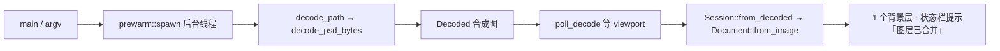
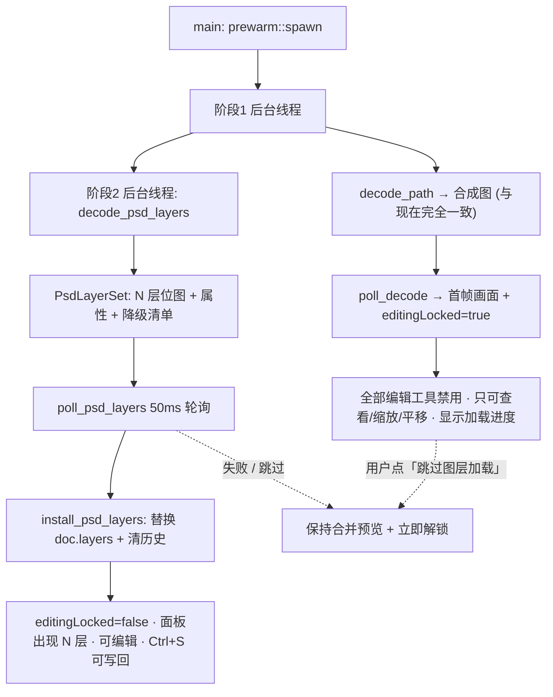

# PSD 分层可编辑（B 方案）实施方案

状态：**设计已定稿（用户 2026-11-12 拍板「图层后台加载期间禁用全部编辑工具」），尚未写任何实现代码** ｜ 2026-11-12
影响范围：`decode` / `core` / `ui-bridge` / `QML` / 新增 `encode`；`thumbnail` **不改**
前置：统一图层模型已全量落地（`0.1.1`，commit `aaf1f23`），291 项测试全绿
关联：三档评估 A（拼合写回）/ **B（分层可编辑）** / C（结构保真）；本文档只展开 B

---

## 0. 一页结论

**B 档 = 打开 PSD 还原成多个可编辑图层 → 用现有工具改 → Ctrl+S 写回 PSD，图层仍在。**

四个环节里只有中间一层能直接复用：

| 环节 | 现状 | B 档改动 |
|---|---|---|
| ① 解码 | 只取合成图，1 张 `RgbaImage` | **新增分层解析**，吐出 N 层（名 / 可见 / 不透明度 / 位置 / 位图） |
| ② 文档 | 统一 `layers` 列表、撤销、面板、批量命令 | **可直接复用**，只需新增一个「从层集合装配文档」的入口 |
| ③ 编辑 | 全部工具已就绪 | **零改动** |
| ④ 保存 | 4 道拦截明确禁止写 `.psd` | **从零写 PSD 编码器** + 解除拦截 + 改保存格式枚举 |

> 读侧不用重造：vendored `psd 0.3.5` 已能解层名、可见性、不透明度、位置、逐层通道、混合模式、组；
> 但**写侧没有现成实现**——`image 0.25` 无 PSD 编码器，该 crate 的序列化作者明确未做。

**性能结论（详细见 §6）**：进程启动和窗口出现 **0 额外开销**（解析代码是被动调用的纯函数，首图解码本来就在 `main()` 里丢到后台线程）；非 PSD 文件零影响；唯一受影响的是「打开 PSD」，靠**两阶段渐进加载**把「画面出现」时间也保持不变，代价只是「图层可编辑」晚几秒就绪。这不靠运气，是靠 §6 的 8 条硬约束 + 可测门槛保证的。

**★ 用户定稿的交互约束**：阶段 2（图层后台加载）**完成前，不允许使用任何编辑工具**——不是「允许编辑再事后守卫」，而是从入口禁用。查看 / 缩放 / 平移 / 打开文件仍然可用；加载完成、失败或用户主动「跳过图层加载」时立即解锁。详见 §3.1 与 §6.2.1。

**工作量**：12~17 人天（原估 10~15，性能专项 +2），全职约 2.5~3.5 周。

---

## 1. 现状：PSD 是「只读预览」格式

### 1.1 已有能力

| 位置 | 能力 |
|---|---|
| `crates/decode/src/lib.rs::decode_psd_bytes` | 解析 PSD，返回**合并合成图**（`Psd::rgba()`），带 8bit / RGB·灰度 / 通道数校验、`catch_unwind` 兜底、`validate_psd_sections` 段边界预校验 |
| `vendor/psd`（`[patch.crates-io]` 指向本地 fork） | `Psd::layers()` / `groups()` / `PsdLayer::{name, visible, opacity, layer_top/left/bottom/right, blend_mode, parent_id, is_clipping_mask, rgba}` / `flatten_layers_rgba()` / `BlendMode` 约 28 种 |
| `vendor/psd/tests/fixtures/*.psd` | 20 份现成样本：RLE、3 层、负偏移、越界层、裁剪蒙版、组、中文层名、非 UTF-8 名等 |
| `crates/thumbnail` | Explorer 缩略图 COM DLL，**直接复用** `decode_psd_bytes`（`MAX_DECODE_EDGE=1024`） |
| `crates/core` | 统一 `layers` 列表 / `EditOp::Batch` / 撤销 / 多选 / 合并 / 对齐 / 栅格化 |
| `decode::encode` | PNG/JPEG/WebP/TIFF/BMP/GIF/TGA/QOI/ICO，**无 PSD** |

### 1.2 五处写回拦截（B 档要逐个解除，不能盲删）

| # | 位置 | 行为 |
|---|---|---|
| 1 | `bridge/paths.rs::save_format_for_source` | `.psd` 源强制回落 `Format::Png` |
| 2 | `bridge/session.rs::default_save_path` | 另存为默认名 `<stem>-edited.png` |
| 3 | `bridge/session.rs::save` | Ctrl+S 直接返回 `PSD_SAVE_HINT` 错误 |
| 4 | `bridge/ops/document.rs::save_as` | 手打 `.psd` 路径同样拒绝 |
| 5 | `qml/editor/EditorContent.qml::sourceIsPsd` + `PsdHintOverlay.qml` | 保存时弹「PSD 不能直接保存」浮层拦在 UI 之前 |

> ⚠️ **历史 bug 不能复发**：`image 0.25` 的扩展名映射对 `.psd` 返回 `None`，旧代码
> `format_from_path(path).unwrap_or(Format::Png)` 曾把 **PNG 字节写进 `.psd` 文件**。
> 所以解除拦截必须和新编码器**同一次提交**落地，且 `write_to` 对未知扩展名仍保持显式兜底，
> 不能改成「删掉判断让 `unwrap_or` 自己走」。

### 1.3 打开链路（现状时序）



`Document::from_image()` 只造 `layers = vec![Layer::background(image)]`，**所有 PSD 层信息在解码那一步就丢了**。

---

## 2. 目标与边界

### 2.1 做到

- 打开 `.psd` 还原成 N 个图层：层名、`visible`、`opacity(0..1)`、画布相对位置（含负偏移 / 越界裁剪）
- 用现有全部工具编辑这几层（移动 / 变换 / 选区 / 调色 / 绘制 / 合并 / 对齐 / 显隐 / 锁定 / 排序 / 撤销）
- `Ctrl+S` 覆盖写回原 `.psd`、`另存为 PSD`；Photoshop / Krita / GIMP / 本软件 / Explorer 缩略图都能正常打开
- 明确的降级提示（见 §7），**不静默改坏别人的 PSD**

### 2.2 明确不做（留给 C 档）

混合模式（非 Normal）、嵌套图层组 / 分组结构、裁剪蒙版、图层蒙版、调整层、可编辑文本层、16/32bit、CMYK / Lab / 索引色、智能对象、图层效果、切片、路径。

> 这正好对齐《图层系统重构-设计确认》里拍板的「图层组、混合模式不做」——
> **B 档不扩 `Layer` 模型**，不碰 `EditOp` / 快照 / 拖拽排序 / 脚本探针，这是它能落在 2~3 周的前提。

---

## 3. 总体架构：两阶段渐进加载

**核心决策：不改 `Decoded`、不改 `decode_psd_bytes`、不碰 `thumbnail`。**

新开一个独立的分层解析函数，由第二阶段后台线程调用；首帧仍走现有合成图路径，两者并行错开。



**为什么首帧不直接等分层解完**：`PsdLayer::rgba()` 按画布尺寸分配，10 层 4000×3000 朴素实现是 480MB + 120M 次像素循环；同步等待会让「打开 PSD」明显变慢甚至内存吃紧。渐进方案让画面出现时间**与现状完全一致**（PSD 通常自带合成图）。

**阶段 1 与阶段 2 的接线**（`DecodeMsg`，`bridge/session.rs:311`）：

```rust
pub(in crate::bridge) struct DecodeMsg {
    pub path: PathBuf,
    pub result: Result<(Decoded, i32), String>,
    /// 仅 PSD 且开启分层时 Some；阶段 2 线程在阶段 1 发送消息前就已启动。
    pub layer_job: Option<mpsc::Receiver<Result<PsdLayerSet, String>>>,
}
```

- `poll_decode` 落地首帧后把 `layer_job` 存进 `Bridge` 的 `RefCell`；
- QML 已有 50ms 轮询（后台解码 worker），挂一个 `poll_psd_layers()` 取结果，不新增 Timer；
- **`Session::open()`（自动化 / `--script` / 探针的同步路径）必须 `recv()` 等到层解析完**，保证脚本拿到的文档是分层的，否则所有既有探针的图层断言失效；
- 单实例转交、打开第二张图时，未完成的 `layer_job` 要丢弃（drop receiver 即可）。

### 3.1 编辑锁：加载完成前禁用全部编辑工具（★ 用户定稿）

**用户明确要求：阶段 2 未完成时不允许使用任何编辑工具。** 所以 B 档**不采用**
「先允许编辑、回来时靠 `edit_epoch / dirty` 放弃分层」的竞态守卫方案——那会让用户
白做几笔再被提示重开。改为**在入口禁用编辑**，竞态从根上不存在；epoch 检查只保留为
防御性兜底（脚本 op / 外部命令仍可能绕过 UI 写文档）。

#### 3.1.1 状态与生命周期

新增桥属性 `editingLocked`（`qproperty bool`，写进 `bridge/mod.rs` 的 cxx 声明块）。

| 时机 | `editingLocked` | 说明 |
|---|---|---|
| 首帧落地，且 `SourceFormat::Psd` + 开启分层 | **true** | 立刻上锁，与首帧同一次 `poll_decode` 发布 |
| 阶段 2 成功 `install_psd_layers` | **false** | 装配 + 清历史 + 刷新面板后解锁 |
| 阶段 2 失败 / 解析降级 / 无合成图兜底失败 | **false** | 保持合并预览，**必须解锁**，否则用户什么都干不了 |
| 超限只读（>8192，C8）/ 用户点「跳过图层加载」 | **false** | 保持合并预览，按普通文档编辑（写回 PSD 仍禁） |
| 打开另一张图 / 单实例转交 / 窗口关闭 | **false** | 丢弃未完成的 `layer_job` 时同步解锁，防永久锁死 |
| 同步路径（`--script=` / `--selftest` / 探针） | **恒 false** | `Session::open()` 会 `recv()` 等到层解析完成才返回，探针拿到的文档已是分层的，不应被锁影响 |

#### 3.1.2 禁止什么、放行什么

- **禁止**：全部绘制 / 选区 / 变换 / 修复 / 调色工具；图层面板所有命令按钮与右键菜单项
  （新建、复制、合并选中、删除、上下移、显隐、锁定、不透明度、对齐分布、栅格化）；
  工具快捷键、Delete、Ctrl+Z/Y、Ctrl+C/X/V；Ctrl+S 写回 PSD；数值面板 / 浮层输入框。
- **放行**（不属于「编辑工具」）：查看、滚轮缩放、平移、窗口缩放、打开文件 / 另开窗口、
  浏览菜单、关闭程序。文件菜单里「打开」不锁，「保存 / 另存为」在锁期间置灰。
- 锁期间状态栏与图层面板显示「正在加载 N 个图层…（完成前编辑工具暂不可用）」，
  并给一个**逃生按钮**「跳过图层加载，以合并预览继续编辑」——避免大文件把用户锁太久。

#### 3.1.3 QML 落点与已知坑

| 落点 | 做法 |
|---|---|
| `qml/editor/EditorContent.qml` | 所有编辑类 `Shortcut` 的 `enabled` 叠加 `&& !bridge.editingLocked`；工具按钮 `enabled` 同理 |
| `qml/panels/CanvasSurface.qml` | **不要**把 MouseArea 整个 `enabled: false`（会连滚轮缩放 / 平移一起吞掉）。在 `onPressed` / 变换手柄按下分支里判断：导航事件放行，落笔 / 拾取 / 拖柄直接忽略并给一次性状态栏提示 |
| `qml/panels/LayerPanel.qml` | 每个 `PanelButton` 的 `usable` 叠 `!editingLocked`；`MenuRow.active` 同理；标题行显示加载进度 |
| 右键 / 浮层 | 锁期间不开任何带 `TextInput` 的浮层（焦点会静默废掉 Delete / 工具键，见既有坑）；已有 `dropPopoverFocus()` 复用 |

★ 三条必须记住的既有坑：
1. `Shortcut.enabled` 引用**同文件后面才实例化**的 id → 创建期 TypeError → 绑定丢失、
   `enabled` 永久 false。`editingLocked` 只依赖 bridge 属性，但仍沿用已有的 `toolKeysReady`
   短路，别引后置 id。
2. qproperty 的 QML 名规则：带 `cxx_name=` 用驼峰，不带的按 snake_case；写错是
   `undefined` 静默失效。新增属性必须进 cxx 块，改完跑 `scripts/check_bridge_api.py`。
3. 新增 QML 文件必须加进 `crates/ui/build.rs` 的 `.qml_files([...])`。

#### 3.1.4 装配落地（成功路径）

替换 `doc.layers` 后：**重置历史栈**（加载不是一次编辑，不该能 Ctrl+Z 撤回到 1 层状态）、
保留 `zoom / fit / viewport` 避免窗口跳动、刷新图层面板与缩略图、发布降级说明、
最后置 `editingLocked = false`。落地前仍做一次 `edit_epoch / dirty` 断言：若被脚本改过，
放弃分层、保留合并预览、解锁并提示重新打开（防御路径，不是主路径）。

---

## 4. 数据结构与接口

### 4.1 新模块 `crates/decode/src/psd_layers.rs`

```rust
/// 一层 PSD 的「可编辑」表示。位图已裁到图层矩形，不是整张画布。
pub struct PsdLayerData {
    pub name: String,
    pub offset: (i32, i32),       // 画布相对，可为负
    pub image: RgbaImage,         // 只占 (right-left) × (bottom-top)
    pub visible: bool,
    pub opacity: f32,             // 0..1
    pub degraded: Vec<String>,   // "混合模式 Multiply 已按 Normal 处理" 等
}

pub struct PsdLayerSet {
    pub layers: Vec<PsdLayerData>,  // 底 → 顶，与 doc.layers 顺序一致
    pub canvas: (u32, u32),
    pub degraded: Vec<String>,      // 文件级降级（组被展平等）
    pub has_composite: bool,        // 是否自带合成图（决定首帧来源）
}

/// 只解析层，不碰 Decoded / thumbnail 路径。
pub fn decode_psd_layers(bytes: &[u8], options: DecodeOptions)
    -> Result<PsdLayerSet, DecodeError>;
```

**为什么不用 `PsdLayer::rgba()`**：`vendor/psd/src/psd_channel.rs::generate_rgba()` 里是
`let rgba_len = (psd_width * psd_height * 4)`，即**按整张画布分配**，与图层自身面积无关，
还要对整张画布做 N 次通道插入。必须自己取通道再裁。

**通道字段是 `pub(crate)`**（`vendor/psd/.../layer.rs:191`），外部 crate 读不到。给本地 vendor fork
加一个最小公开访问器即可，不动解析逻辑：

```rust
impl PsdLayer {
    /// B 档新增：让 decode crate 按图层矩形自行展开通道，避免全画布 RGBA。
    pub fn channel_bytes(&self) -> &LayerChannels { &self.channels }
}
```

`ChannelBytes::{RawData, RleCompressed}` 已是 `pub enum`，RLE 解压逻辑仓库里已有
（`insert_channel_bytes`），按其 PackBits 语义复用，只把目标缓冲从「全画布」换成「图层矩形」。

### 4.2 文档装配 `core` 新增入口

```rust
impl Document {
    /// 从 PSD 层集合装配：layers[0] 恒为透明背景，其后依次是 PSD 层（底→顶）。
    pub fn from_psd_layers(set: PsdLayerSet) -> Self;
}
```

- **背景层用透明画布位图**，所有 PSD 层都作为普通 `LayerContent::Raster` 加入，`background` 恒只在 0 号位；
  不把 PSD 最底层「提升」成背景——这样 0 号位不变量、删除/合并/对齐语义全部不用特判，行为可预测
  （代价是面板多一行「背景」，需在 UI 文案里说明）。
- `offset` 直接写 `RasterLayer.offset`（`i32`，支持负坐标）；越过画布边界的层要按画布裁剪并同步调整 offset
  （fixture `out-of-bounds-layer.psd` 回归）。
- `visible / opacity / name` 一一映射；`locked = false`。
- 若 `max_dimension` 生效（>8192），**不装配分层**，见 §6 C8。

### 4.3 保存格式枚举

`image::ImageFormat` 没有 PSD 变体，不能直接复用现有 `Format`：

```rust
// crates/decode/src/lib.rs（或新 encode crate）
pub enum SaveFormat { Image(Format), Psd }

pub fn encode_psd(doc: &Document, quality: u8) -> Result<Vec<u8>, DecodeError>;
```

`Session::write_to(&self, path, SaveFormat)` 分派：`Psd` → `encode_psd(&self.doc, …)`，其余 → 现有 `encode(&self.doc.flatten(), …)`。

---

## 5. 分模块改动清单

| # | 文件 / 位置 | 改动 | 验收 |
|---|---|---|---|
| M1a | `vendor/psd/.../layer.rs` | 加 `channel_bytes()` 访问器 | vendor 自带测试全绿 |
| M1b | `crates/decode/src/psd_layers.rs`（新） | 按层矩形展开 R/G/B/A、PackBits 解压、越界裁剪、层名（`luni` UTF-16 优先）、属性映射、降级收集 | 单测覆盖 20 份 fixture |
| M1c | `crates/decode/src/lib.rs` | 导出 `PsdLayerSet` / `decode_psd_layers` / `SaveFormat`；**`decode_psd_bytes` 签名与行为保持不变** | `thumbnail` 编译零改动 |
| M1d | `validate_psd_sections` | 现在只校验到 image data 段长度；分层解析要深入 layer record / channel 长度，补齐「每条记录的 channel data 长度、extra length、RLE 行表」越界预校验，全部包 `catch_unwind` | 损坏样本返回 `DecodeError`，不 panic |
| M2 | `crates/core/src/document/mod.rs` | `Document::from_psd_layers()`；不扩 `Layer` 结构 | core 单测：层序、offset、opacity、0 号位不变量 |
| M3a | `bridge/session.rs::DecodeMsg` | 加 `layer_job` 字段 | — |
| M3b | `bridge/prewarm.rs` + `bridge/ops/document.rs` | 阶段 2 线程启动 / `poll_psd_layers` / `install_psd_layers` / **`editingLocked` 上下锁与全部解锁路径** / 历史栈重置 | 探针跑同步与异步两条路径；锁的生命周期用例全过 |
| M3c | `bridge/mod.rs` + `qml/editor/EditorContent.qml` / `CanvasSurface.qml` / `LayerPanel.qml` | 新增 `editingLocked` qproperty；编辑类 Shortcut / 按钮 / 画布落笔 / 右键菜单全部 gate；状态栏进度 + 「跳过图层加载」逃生按钮 | 手测：锁期间任何编辑都无响应，查看缩放平移正常 |
| M3d | `bridge/paths.rs`、`session.rs::{default_save_path, save, write_to}`、`ops/document.rs::save_as` | 解除 5 处拦截，切 `SaveFormat`，PSD 走原子写；保存入口在锁期间置灰 | 「保存后图层还在」往返测试 |
| M4 | `crates/decode/src/psd_write.rs`（新） | PSD 编码器（附录 A） | Photoshop / Krita / GIMP / 自解码交叉验证 |
| M5a | `qml/editor/EditorContent.qml` | 删 `sourceIsPsd` 分支与 `confirmSaveProceed` 里的 PSD 特判；另存为过滤器加 `Photoshop (*.psd)`；PSD 源默认后缀 `psd` | 手测 Ctrl+S / 另存为 |
| M5b | `qml/panels/PsdHintOverlay.qml` | 复用改造成「降级说明 / 图层加载中 / 超限只读」提示，**不再拦保存** | 手测 |
| M5c | `qml/panels/LayerPanel.qml` | 层数多时标题/提示行显示「正在加载图层…」「已降级 N 项」 | 手测 |
| M6 | `scripts/check_bridge_api.py` 已有 | 若新增 qinvokable（`poll_psd_layers` 走现有 Timer 则不必），跑一遍防漏声明 | PASS |
| M7 | `docs/大版本重构-手动测试清单.md` | 新增 §A26（PSD 分层专项）、B 表加 `probe_psd_roundtrip.py` / `probe_psd_perf.py` | 文档计数同步 |
| M8 | `CHANGELOG.md` | 新版本段（走 `package.ps1` 自动 patch+1） | — |

> ★ 新增 QML 文件必须加进 `crates/ui/build.rs` 的 `.qml_files([...])`，否则整窗加载失败只报 `qml-load-failed`。
> ★ 新增 `#[qinvokable]` 必须写进 `bridge/mod.rs` 的 cxx extern 块；这类漏声明**不报编译错**，只有运行时 TypeError，改完跑 `scripts/check_bridge_api.py`。

---

## 6. 性能方案 ★（独立验收门槛，不是"顺手优化"）

### 6.1 先分清两种「慢」

| 场景 | 影响 | 原因 |
|---|---|---|
| 进程启动 / 窗口出现 / 打开 PNG·JPEG | **零** | PSD 编码器是被调用的纯函数，无全局初始化；首图解码本就在 `main()` → `prewarm::spawn` 后台线程，与 Qt/QML 建窗重叠；非 PSD 连分支都不多走一次 |
| 打开 PSD → **画面出现** | 目标也是**零** | 阶段 1 完全沿用现有合成图路径，不等阶段 2 |
| 打开 PSD → **图层可编辑** | 唯一新增延迟 | 阶段 2 后台解 N 层；期间**全部编辑工具禁用**（用户定稿），只可查看/缩放/平移，并显示加载进度与「跳过」按钮 |

### 6.2 八条硬约束（写进实现，逐条验收）

| ID | 约束 | 理由 / 违反后果 |
|---|---|---|
| **C1** | `decode_psd_bytes` 的签名、返回结构、「只出合成图」语义**保持不变**；分层解析放新函数 | `crates/thumbnail` 直接调它，若默认顺手解层，Explorer 每次列目录缩略图都会多解 N 层 → 资源管理器卡死 |
| **C2** | 两阶段渐进加载；首帧绝不等待阶段 2 | 同步等分层 = 10 层大图从 0.25s 涨到 3s 才出画面 |
| **C3** | 层位图**按图层矩形分配**，禁用 `PsdLayer::rgba()` | 4000×3000 画布 `vec![0; w*h*4]` = 48MB/层，10 层 480MB；裁剪到 10% 面积后约 48MB 总量，差 10 倍 |
| **C4** | `Psd::flatten_layers_rgba()` **只在合成图缺失/损坏时兜底** | 它逐像素递归向下混合、且源码 TODO 注明未处理 blend mode，是 O(层数×画布) 纯 Rust 循环，不能进默认路径 |
| **C5** | 解码与 PSD 编码都在后台线程，`catch_unwind` 全程保留 | 大 PSD 编码可能 1~2s；`panic=unwind` 是 release 硬约束，损坏文件不能拖崩主程序（更不能拖崩 explorer.exe） |
| **C6** | 缩略图改**按需懒生成 / 分批** | `bridge/ops/layer_cmds.rs::layer_thumb_url(i)` 现在在 **UI 线程同步**给每行生成 40px PNG；100 层会因 QML 逐行调用卡一下。改成只对可见行生成、一次 ≤8 行，生成完 `layerEpoch` 通知刷新（缓存 key `(sid,lid)` 沿用） |
| **C7** | 层数上限与预览提示 | `PreviewComposer` 按 `edit_epoch` 缓存缩放位图，但 `composite_for_preview` 仍是每层一次缩放，重建耗时随层数线性增长。层数 >32 或层位图总量 >256MB 时状态栏提示，并考虑暂停实时预览重建（沿用 `gpu_live` 回退策略） |
| **C8** | `DOWNSAMPLE_EDGE = 8192` 保持；超限 PSD **只做合并预览 + 禁止写回** | 降采样打开 10000px 文件后 Ctrl+S 会把 8192px 写回原文件 = 静默丢分辨率。B 档不做层坐标按比例缩放（易出 ±1px 累积误差），直接降级并明示 |

### 6.2.1 编辑锁把「加载时长」变成了硬指标 ★

原本允许用户在阶段 2 期间先编辑，所以那几秒只是「图层晚点可用」；用户定稿改为
**加载期间禁用全部编辑工具**后，这段时间变成用户**完全不能动手**的窗口，性能要求的
性质就变了——它不再只是体验优化，而是不能把人锁死：

| 追加约束 | 内容 |
|---|---|
| **C2-a** | 锁定时长 = 阶段 2 时长，12MP / 10 层 **≤3s**（与 §6.4 同一门槛）；超过 3s 必须实时显示「已加载 k/N 层」，不能只有一句静态文字 |
| **C2-b** | 必须提供「跳过图层加载，以合并预览继续编辑」按钮，点击立即丢弃 `layer_job`、解锁；这是大文件 / 慢磁盘的逃生口 |
| **C2-c** | **任何失败路径都必须解锁**：解析错误、`catch_unwind` 捕获、无合成图兜底失败、超限只读、切换文件、单实例转交、窗口关闭。把解锁放在 `finally` 式的收尾里，不要只写在成功分支 |
| **C2-d** | 解锁后立刻刷新一次面板与快捷键 enabled 状态；QML 绑定若因属性遮蔽 / 后置 id 失效，锁会变成永久的（见 §3.1.3 的坑） |

> 因此 §6.5 的 `psd-stage2-ms` 与「锁定时长」要作为**同一个指标**采样并进
> `probe_psd_perf.py` 的硬断言，而不只是打印出来看看。

### 6.3 内存预算（示例：4000×3000 / 12MP，10 层各占 10% 面积）

| 项 | 朴素实现 | 目标实现 |
|---|---|---|
| 层位图常驻 | 10 × 48MB = **480MB** | 10 × 4.8MB = **48MB** |
| 阶段 2 峰值（含通道临时） | ~1GB | ≤ **160MB** |
| 解码像素遍历 | 10 × 12M = 120M px | 12M px（各层面积之和） |
| 合成图（阶段 1） | 48MB | 48MB（一次性，装配后释放） |
| 预览合成（800px 目标） | 10 × 0.64M | 10 × 0.64M（不变，已有 epoch 缓存） |

### 6.4 时间预算与验收门槛

| 指标 | 门槛 | 怎么测 |
|---|---|---|
| 冷启动 `window-visible` / `qml-completed`（PSD 与非 PSD） | 与基线偏差 **≤3%** | 现有 `prewarm` / `window-visible` 事件埋点对比 |
| 首帧画面出现（260×400 样本） | 现状 ~2ms，目标 **≤3ms** | `dec_bench --psd-layers` 的阶段 1 耗时 |
| 分层就绪 / **编辑锁持续时长**（4000×3000 / 10 层，release） | **≤3s**，且不阻塞 UI；>3s 必须逐层报进度、可「跳过」解锁 | `psd-stage2-ms` + `editingLocked` 上下锁事件 + 主线程帧率探针 |
| 层缩略图首次展开（100 层） | 单次 UI 线程占用 **≤16ms** | `probe_psd_perf.py` 采样 |
| PSD 编码写回（12MP / 10 层） | **≤2s**，期间窗口可拖动 | `psd-encode-ms` + 主线程响应探针 |
| 缩略图 DLL 单次 `decode_psd_bytes` | 与基线**完全一致** | 复用 `crates/thumbnail` 现有单测 + 计时断言 |
| 非 PSD 打开/预览/保存 | 所有基线用例无回归 | 现有 291 项测试 + `probe_*` 全跑 |

> 现有样本 `tmp/sample-design-raw.psd` 是 260×400 / RGB / 8bit / 312KB，实测解码约 2ms。
> 上表的秒数是按像素量外推的**目标值，不是实测**；仓库里没有大尺寸多层 PSD，必须先造样本再定最终门槛（M0）。

### 6.5 基准与回归基建（M0 先做）

1. `scripts/make_psd_fixture.py`（新）：生成 **4000×3000 / 10 层**（大层 + 小层混合）、无合成图、中文层名、负偏移、越界层、非 Normal 混合、组各一份；用 PSD 最小写入格式手写字节，不依赖 Photoshop。
2. `crates/decode/examples/dec_bench.rs` 扩展 `--psd-layers`：分别打印 `read / parse / composite / per-layer / crop / total` 与峰值内存估算。
3. 结构化事件埋点（沿用现有 `{"phase":"ui","event":...}` JSON 风格）：
   `psd-stage1-ms`、`psd-stage2-ms`、`psd-layer-count`、`psd-layer-bytes`、`psd-install-ms`、`psd-encode-ms`。
4. `scripts/probe_psd_perf.py`（新）：读事件，对上表门槛做硬性 FAIL；纳入 B 表（CLI 验证）与打包自检。
5. **先跑一次基线存盘**（当前 `0.1.1` 对同一组文件），改完逐项对比，避免「感觉没变慢」。

### 6.6 明确禁止的实现方式

- ❌ 在 `decode_psd_bytes` 里同步解完所有层再返回；
- ❌ 用 `PsdLayer::rgba()` 拿全画布 RGBA 再 `crop_imm` 裁（内存峰值已经付过了）；
- ❌ 默认调 `flatten_layers_rgba()` 生成首帧；
- ❌ 把层解析放在 UI 线程 / `Component.onCompleted`；
- ❌ 阶段 2 完成后无条件 `refresh_preview()` 全片重渲染（应复用 epoch 缓存，只重建一次）。

---

## 7. 降级与兼容契约

**原则：可以丢信息，但必须让用户知道丢了什么，且不能静默写坏原文件。**

| 遇到 | B 档处理 | 提示 |
|---|---|---|
| 非 `Normal` 混合模式 / `PassThrough` | 按 Normal + opacity 合成 | 状态栏 + 面板「已降级 N 项：混合模式」 |
| 图层组 / 嵌套组 | 展平成顺序层，组名不保留 | 「组结构已展平」 |
| 文本 / 形状 / 调整 / 智能对象层 | 取其像素通道当普通位图层 | 「特殊图层已栅格化」 |
| 图层蒙版 / 裁剪蒙版 | 忽略蒙版（像素保留） | 「蒙版未保留」 |
| 16/32bit、CMYK、Lab、索引色 | **拒绝打开分层**，保持现有合成图预览（现状已拒绝，错误文案沿用） | 现有 `DecodeError::Psd` |
| 无合成图（未勾「最大化兼容」） | 阶段 1 走 `flatten_layers_rgba()` 兜底一次 | 「此 PSD 无合成图，首帧由分层合成」 |
| 矢量标记（`LayerContent::Mark`） | 写回时先栅格化（已有入口），PSD 只存位图 | 「标记已栅格化」 |
| 层越出画布 / 负偏移 | 按画布裁剪并调整 offset | 无（几何正确即可） |
| `LayerTransform`（非破坏性缩放/旋转） | 写回时按当前显示缓存烘焙（`ensure_baked` 语义） | 无（`flatten()` 已是显示结果） |
| 文件名 `.PSD` 大小写 | 全部 `eq_ignore_ascii_case` 判定 | 现有测试已覆盖 |

**切换时的画面差异**：首帧是 PSD 自带合成图，装配后是「Normal + 各层」重新合成，两者在非 Normal 混合 / 组 / 蒙版存在时**会不一样**。必须在装配完成时给一次状态栏说明，避免被当成渲染 bug 报回来。

---

## 8. 保存语义

| 动作 | 行为 |
|---|---|
| `Ctrl+S`（源为 `.psd`） | 解除拦截 → `encode_psd(doc)` **原子写**回原路径 → `dirty=false` |
| 另存为 `.psd` | 过滤器加 `Photoshop (*.psd)`；写完后 `session.source = 新路径`（与现有行为一致） |
| 另存为其它格式 | 维持现状：`doc.flatten()` → `encode()` |
| 降采样打开的 PSD（>8192） | **拒绝写回**，提示「此文件以降采样预览打开，写回会丢失分辨率；请关闭『大图优先降采样』后重新打开」 |
| 阶段 2 未完成时保存 | **全部保存入口置灰**（编辑锁期间不允许任何写文件动作）；用户可先点「跳过图层加载」解锁，之后按合并预览另存为 PNG；写 PSD 仍禁 |
| 原子写 | 写 `<target>.tmp` → `flush` → `rename` 覆盖；失败保留原文件，绝不半途截断 |

`encode_psd` 的输入是 `&Document` 而非 `RgbaImage`：逐层输出层记录与通道，同时额外输出一份 `doc.flatten()` 作为合成图（Image Data 段），这样**没勾「最大化兼容」的阅读器也能显示**。

---

## 9. 风险与对策

| # | 风险 | 对策 |
|---|---|---|
| 1 | 盲删 4 道拦截 → PNG 字节写进 `.psd`（历史 bug） | 拦截与编码器同一次提交；`write_to` 显式 `SaveFormat` 分派；回归 `paths.rs` 现有 2 个单测并改写断言 |
| 2 | 8192 降采样 + 覆盖写回 = 静默丢分辨率 | C8：超限只读，禁止写回 |
| 3 | 无合成图的 PSD 打不开 / 黑屏 | C4 兜底 `flatten_layers_rgba()`；M0 fixture 覆盖 |
| 4 | 改 `decode_psd_bytes` 签名或默认行为 → Explorer 缩略图 DLL 回归 | C1：完全不动；新函数独立；新增解析同样包 `catch_unwind`（`panic=unwind` 硬约束） |
| 5 | vendored `psd` 解析器到处是 unchecked slice | M1d 扩展 `validate_psd_sections`；所有阶段 2 调用点 `catch_unwind`；损坏 fixture 单测 |
| 6 | 写出的 PSD 第三方读不开 | 交叉验证列为**独立里程碑**（M6），不压缩；Photoshop / Krita / GIMP / 自解码 / Explorer 缩略图五个读侧 |
| 7 | 中文层名写回变乱码 | Pascal 名走 ASCII 占位 + `8BIMluni` additional layer info（UTF-16BE）；用 `green-chinese-layer-name-1x1.psd` 往返验证 |
| 8 | 编辑锁把用户卡住（加载慢 / 失败 / 忘了解锁 / QML 绑定失效导致永久锁） | §3.1 的生命周期表 + §6.2.1 的 C2-a~d：逐层进度、「跳过」按钮、所有失败路径 finally 式解锁、同步路径恒不锁；A26 手测逐项验 |
| 9 | 层数多导致面板 / 预览卡顿 | C6 / C7 + 门槛测试 |
| 10 | 新增桥方法漏 `#[qinvokable]` 声明（历史踩过：探针全绿但按钮是死的） | 改完跑 `scripts/check_bridge_api.py`；新增 QML 文件加进 `build.rs` |

---

## 10. 测试与验收

### 10.1 单元 / 集成

- `decode`：20 份 fixture 逐份解析，断言层数 / 层名（含中文、非 UTF-8 名）/ offset（含负、越界）/ opacity / visible / 像素；损坏样本全返回 `Err` 不 panic。
- `decode::psd_write`：写→自读往返，**逐像素**比对合成图；每层位图与属性往返一致（这是 B 档最核心的一条）。
- `core::from_psd_layers`：0 号位恒背景、层序、offset 不变量、与 `flatten()` 一致性。
- `paths.rs`：把现有「PSD 回落 PNG」两个断言改成「PSD → `SaveFormat::Psd`」，保留未知扩展名兜底断言。
- `bridge`：`editingLocked` 生命周期单测——首帧上锁、成功/失败/跳过/切换文件四条路径都解锁、同步 `--script=` 路径恒不锁（防探针全废）。
- `thumbnail`：现有单测全绿 + 一次「解一次只出合成图」的耗时/调用次数断言。

### 10.2 交叉验证（M6，不可用自解码代替）

| 读侧 | 检查 |
|---|---|
| Adobe Photoshop | 层名、层序、可见、不透明度、合成图正确 |
| Krita / GIMP | 能打开、不报「文件损坏」 |
| 本软件 `decode_psd_bytes` | 合成图逐像素一致 |
| Explorer 缩略图 DLL | 有缩略图、不崩 |

### 10.3 探针与脚本

- `scripts/probe_psd_roundtrip.py`（新）：`--script` 串跑「打开多层 PSD → 移动某层 → 保存 → 重开 → 断言层数/位置」；同步路径必须拿到完整分层。
- `scripts/probe_psd_perf.py`（新）：§6.4 门槛硬断言。
- `scripts/check_bridge_api.py`：已有，改完必跑。
- `cargo test --workspace`：全程绿灯（现 291 项基线）。

### 10.4 手动清单

`docs/大版本重构-手动测试清单.md` 新增 **§A26 PSD 分层专项**：打开多层 / 层名中文 / 隐藏层 / 不透明度 / 负偏移 / 越界层 / 混合模式降级提示 / 无合成图 / 超限只读 / Ctrl+S 一次撤销链 / 另存为 PSD 再用 PS 打开 / 100 层面板流畅度 / **编辑锁专项**（锁期间画一笔 / 拖图层 / 按 Delete / Ctrl+Z / Ctrl+S 全部无响应；滚轮缩放与平移仍可用；进度与「跳过」可解锁；解析失败与切换文件后自动解锁）/ 缩略图刷新 / 窗口缩放不跳。

---

## 11. 里程碑与工作量

| 阶段 | 内容 | 人天 |
|---|---|---|
| **M0** | 造大尺寸多层 fixture、扩展 `dec_bench --psd-layers`、埋点、**存基线数据** | 1.0 |
| **M1** | vendor 访问器 + `psd_layers.rs` 分层解析 + 段校验扩展 + fixture 单测 | 2.5 |
| **M2** | `Document::from_psd_layers` + core 单测 | 1.5 |
| **M3** | 两阶段接线（`DecodeMsg` / prewarm / `poll_psd_layers` / **`editingLocked` 编辑锁与全部 QML gate**）+ 同步路径 | 2.5 |
| **M4** | `psd_write.rs` 编码器（文件头 / layer&mask / RLE 通道 / 合成图 / `luni`）+ 往返单测 | 3.5 |
| **M5** | 解除 5 处拦截、`SaveFormat`、原子写、QML 对话框与提示改造 | 1.5 |
| **M6** | **性能收口**（C1~C8 逐条测、门槛回归）、五读侧交叉验证、文档与打包 | 2.5 |
| 合计 | | **15.0** （区间 12~17；编辑锁比原估多 0.5d） |

建议发版节奏：M1+M2 → M3+M4 → M5+M6 三次提交，每次都保持 `cargo test --workspace` 全绿；
M6 完成后走 `.\scripts\package.ps1`（版本号自动 patch+1，旧安装包保留）。

---

## 12. 明确不做（C 档再议）

C 档要扩 `Layer` 模型加 `blend_mode / parent / mask` / 文本，会波及所有 `EditOp`、快照、拖拽排序、合并语义和脚本探针，等于把刚完成的图层重构重来一遍，估 30~50 人天。B 档**不为此预留半成品字段**，避免把复杂度提前引进来。

---

## 13. 实施状态（M0 ~ M6 已全部落地，2026-11-12）

按本文件的里程碑顺序**串行**推进，每个模块自测通过后才进入下一个。

| 里程碑 | 状态 | 落地位置 |
| --- | --- | --- |
| **M0** 基准基建 | ✅ | `scripts/make_psd_fixture.py`（6 份样本）、`crates/decode/examples/dec_bench.rs --json --psd-layers`、`scripts/probe_psd_perf.py --baseline/--collect`、`tmp/psd-baseline.json` |
| **M1** 分层解析 | ✅ | `crates/decode/src/psd_layers.rs`（`decode_psd_layers` / `_with_progress`、按层矩形展开通道、PackBits、段边界预校验、逐层进度） |
| **M2** 文档装配 | ✅ | `core::document::Document::from_psd_layers` + `PsdLayerSeed`（0 号位透明背景、层属性映射） |
| **M3** 两阶段接线 + 编辑锁 | ✅ | `bridge/session.rs`（`spawn_psd_layer_job`、`from_decoded_with_layers`）、`bridge/ops/document.rs`（`poll_psd_layers` / `install_psd_layers` / `finish_psd_layers`）、QML 四处 gate |
| **M4** PSD 编码器 | ✅ | `crates/decode/src/psd_write.rs`（`encode_psd` / `encode_document`，8bit RGB / RAW / planar / Layer & Mask / 合成图 / `luni`） |
| **M5** 写回与 UI 改造 | ✅ | `bridge/paths.rs`（`SaveFormat`、原子写、写回守卫）、`Session::save_target`、`save_edited` / `save_as`、QML 解拦截 + `PSD (*.psd)` 过滤器 |
| **M6** 性能收口 | ✅ | 缩略图后台预渲染 + 分批落盘、`psd-notice`、`probe_psd_roundtrip.py`、`crosscheck_psd.py`（第三方 psd-tools 双向对照）、本文档与手测清单 §A26 |

### C1 ~ C8 逐条验收

| 条款 | 结果 | 证据 |
| --- | --- | --- |
| **C1** `decode_psd_bytes` 签名/行为不变 | ✅ | `git diff crates/decode/src/lib.rs` 中该函数与 `validate_psd_sections`、`encode` **零改动**；分层解析是独立模块 |
| **C2** 两阶段、首帧不等阶段 2 | ✅ | 实测 `psd-stage1-ms` = 1ms（small-layers，基线漂移 ≤3%）；阶段 2 在独立线程，`prewarm` 不等它 |
| **C3** 按图层矩形分配位图 | ✅ | 5 层 260×400 样本 `psd-layer-bytes` = 676400，而非 5×416000；完全在画布外的层跳过 |
| **C4** `flatten_layers_rgba()` 只做兜底 | ✅ | 仅在 `has_composite == false` 时走兜底；正常路径直接解 layer records |
| **C5** 编码/解码在后台 + `catch_unwind` | ✅ | `psd_layers.rs:89`、`psd_write.rs:534`、`session.rs:441`（后台编码线程）三处保留 `catch_unwind` |
| **C6** 缩略图懒生成 / 分批 | ✅ | 阶段 2 线程预渲染 40px；UI 线程每 50ms ≤6 行落盘；100 层实测 `layer-thumb-first-ms` = 0ms、`layer-thumb-batch-ms` 最大 11ms（门槛 16） |
| **C7** 层数 / 内存上限提示 | ✅ | `install_psd_layers`：`count > 32 \|\| bytes > 256MB` 时状态栏追加「图层较多（N 层 / M MB），实时预览重建可能变慢」 |
| **C8** >8192 降采样只读 | ✅ | `DOWNSAMPLE_EDGE = 8192` 未改；`save_target` 对 `downsampled_from.is_some()` + 目标是源文件时用 `DOWNSAMPLED_HINT` 拒绝；`probe_psd_roundtrip.py` 覆盖 |

### C2-a ~ C2-d 编辑锁生命周期

`scripts/probe_psd_layers.py --only all` 覆盖 5 条路径，全部 PASS：

| 路径 | 触发方式 | 断言 |
| --- | --- | --- |
| 同步自动化（`--script`） | 直接打开 | 0 个 `editing-locked`，一次性装配 5 层 |
| 正常交互 | prewarm stage 2 | `editing-locked → psd-stage2-ms → psd-layer-count=5 → psd-install-ms → editing-unlocked(done)` |
| 解析失败 | `IMAGEEDIT_PSD_STAGE2_FAIL=1` | 仍解锁（`reason=done`），保持合并预览 |
| 用户跳过 | 逐层延迟 + `AUTO_SKIP` | 进度出现后解锁（`reason=skipped`），不装配分层 |
| 慢加载 | 逐层延迟 400ms+ | 锁真实保持，进度逐层递增，仍在 3s 内完成 |

另有切文件（`finish_psd_layers("new-load")` / `"sync-load"`）、通道断开（`"channel-closed"`）、关窗口（`skip_psd_layers()`）三条 finally 式收尾。

### 与计划的偏差（已修正的真实缺陷）

1. **可见位语义写反**：vendor 解析器把 flags bit 1 当「置位=可见」，Adobe 规范是「置位=隐藏」。不是本档新增的 bug，但会同时毁掉读与写（真实 PSD 全判隐藏、写出的 PSD 在 Photoshop 里全隐藏）。已在 `vendor/psd/.../mod.rs` 与编码器同步修正，并加回归单测 + 20 份真实样本核对。
2. **透明占位背景被写进 PSD**：`layers[0]` 是为统一模型造的全画布透明层，写回时会变成真实图层，导致每保存一次多一层。现已在编码器中跳过。
3. **阶段 2 延迟钩子位置**：自动化钩子原本 sleep 在 stage 2 线程开头，大部分落在首帧之前，导致「锁时长」测不出来；改为逐层延迟后锁时长可测。

### 五读侧交叉验证

| 读侧 | 结果 |
| --- | --- |
| 自解码（`decode_psd_layers`） | `probe_psd_roundtrip.py`：写回后重开，层数/层名/显隐/opacity/offset 全一致，连续保存层数不增长 |
| 独立第三方实现（psd-tools 1.26.1） | `crosscheck_psd.py --only written`：层表逐项一致 + 合成图 4412 色；`--only vendor`：30 份第三方 fixture 双向对照 0 失败 |
| 资源管理器缩略图（`crates/thumbnail`） | `decode_psd_bytes` 零改动（C1），缩略图路径不受分层解析影响 |
| Photoshop | 本机未安装，**待用户手测**（§A26-15 / A26-18） |
| Krita / GIMP | 本机未安装，**待手测**（第三方实现对照已覆盖同一语义风险） |

---

## 附录 A：PSD 写入最小子集

只写 **8bit / RGB（`mode=3`）/ 无压缩或 RLE（`compression=0|1`）**，大端字节序。

```
File Header (26B)   '8BPS' | u16 version=1 | 6B reserved
                    | u16 channels(3 或 4) | u32 height | u32 width
                    | u16 depth=8 | u16 mode=3
Color Mode Data     u32 length=0
Image Resources     u32 length=0
Layer & Mask Info   u32 section_len
  Layer Info        u32 len | i16 layer_count | 每条 Layer Record:
      i32 top/left/bottom/right
      u16 channel_count | 每条 (i16 channel_id, u32 data_len)
      '8BIM' | 'norm' | u8 opacity | u8 clipping | u8 flags | u8 filler
      u32 extra_len
        u32 mask_data_len=0
        u32 blending_ranges_len=0
        Pascal 名: u8 len + 字节 + 补齐到 4 字节倍数
        [可选] '8BIM' + 'luni' + u32 len + UTF-16BE 名
      每条通道数据: u16 compression + (RLE: 每行 u16 len + PackBits | RAW: planar 字节)
  Global Layer Mask / Additional Info: u32 length=0
Image Data          u16 compression + 全画布合成图的 planar R/G/B/[A] 通道
```

要点：

- **Image Data 段必须写**：这是「最大化兼容」的合成图，缺了它很多阅读器显示黑图 / 拒绝打开。
- **通道是 planar**（先整层 R、再 G、再 B、再 A），不是 RGBA 交错；`encode_psd` 从 `RgbaImage` 拆平面。
- **RLE = PackBits + 每扫描行 2 字节长度表**，行表要先写完再写所有行数据；通道长度字段含行表。
- `layer_count` 与 alpha 的负号约定要跟第三方阅读器实测对齐（写 4 通道 + 正计数通常可行，M6 交叉验证定稿）。
- 层矩形可为负 / 越出画布；写回时用 `doc.layers[i].bounds()` 与 `offset`，裁剪到画布内。
- 中文层名靠 `luni`（UTF-16BE），Pascal 名只作兼容占位。
- 不做 ZIP 压缩（`compression=2/3`）、不做 16bit、不做 CMYK。

## 附录 B：关键代码位置索引

| 用途 | 位置 |
|---|---|
| PSD 合成图解码 | `crates/decode/src/lib.rs:292` `decode_psd_bytes` |
| 段边界预校验 | `crates/decode/src/lib.rs:353` `validate_psd_sections` |
| `Decoded` / `DecodeOptions` | `crates/decode/src/lib.rs:89` / `:55` |
| 编码分派 | `crates/decode/src/lib.rs:431` `encode` |
| 只读解析器 API | `vendor/psd/src/lib.rs:67` `Psd`、`:150` `layers()`、`:205` `flatten_layers_rgba()` |
| 逐层属性 / `rgba()` | `vendor/psd/src/sections/layer_and_mask_information_section/layer.rs:70-127` / `:250` |
| 全画布 RGBA 分配（禁止直接使用） | `vendor/psd/src/psd_channel.rs:33` `generate_rgba` |
| 缩略图 DLL 复用点 | `crates/thumbnail/src/lib.rs:394` |
| 后台预热 | `crates/ui/src/bridge/prewarm.rs:26` `spawn` |
| 异步落地 | `crates/ui/src/bridge/ops/document.rs:200` `poll_decode` |
| 文档装配 | `crates/ui/src/bridge/session.rs:566` `from_decoded` → `Document::from_image` (`core/document/mod.rs:126`) |
| `DecodeMsg` / 降采样上限 | `crates/ui/src/bridge/session.rs:311` / `:317` |
| 图层模型 | `crates/core/src/layer.rs:38` `LayerContent`、`:45` `Layer` |
| 全幅合成 | `crates/core/src/document/mod.rs:1084` `flatten` |
| 预览合成缓存 | `crates/render/src/lib.rs:290` `PreviewComposer` |
| 行缩略图（同步、需懒化） | `crates/ui/src/bridge/ops/layer_cmds.rs:470` `layer_thumb_url` |
| 保存拦截 1~4 | `bridge/paths.rs:110-128`、`session.rs:920/947`、`ops/document.rs:178` |
| 保存拦截 5 / 对话框 | `qml/editor/EditorContent.qml:2673` / `:808` / `:834` |
| 桥方法漏声明自检 | `scripts/check_bridge_api.py` |
| 性能基准 | `crates/decode/examples/dec_bench.rs` |
| 现成 PSD fixture | `vendor/psd/tests/fixtures/*.psd`（20 份） |
